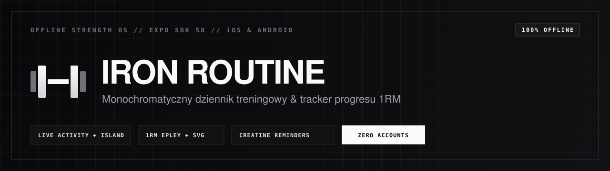

<div align="center">
  
  <br /><br />
  <p><b>Minimalistyczny, monochromatyczny dziennik treningowy i tracker progresu siłowego (iOS & Android, 100% offline)</b></p>

  <p>
    <a href="https://iron-routine-app.vercel.app"></a>
    <a href="https://github.com/matiqueue/iron-routine/releases"></a>
    <a href="https://github.com/matiqueue/iron-routine/actions/workflows/ci.yml"></a>
    <a href="https://github.com/matiqueue/iron-routine/issues"></a>
    <a href="https://matiqueue-portfolio.vercel.app"></a>
  </p>
</div>

> **Portal projektu, dokumentacja i pobieranie APK:** [iron-routine-app.vercel.app](https://iron-routine-app.vercel.app)

---

## Najważniejsze funkcje (v2.0.0)

- **Monochrome AMOLED UI + Responsywność od 375 pt**: Czysta paleta czerni `#000000` i ciemnych kart `#121214` (plus tryb jasny) z dopracowanymi marginesami dla starszych i nowszych iPhone'ów (`iPhone X / XS` oraz `16 Pro`) i płynnym zamykaniem popupów gestem przesunięcia w dół (`InteractiveBottomSheet` + `BottomSheetScrollView`).
- **4-krokowy animowany Onboarding & Jeden Profil**: Neutralny start dla nowego użytkownika: parametry ciała, lista suplementów (`Zalecane` / `Wg masy g/kg` / `Własna`), zgody Apple Health / Health Connect i wybór planu startowego (lub `Importuj JSON`).
- **Jeden Profil, Wiele Planów i Wspólne Rekordy PR**: Przełączaj schematy treningowe (np. FBEOD, Upper/Lower, PPL) bez utraty historii serii, szacowanego 1RM ani wykresów postępu.
- **Konfiguracja Sesji Przed Startem (Drag & Drop)**: Przed rozpoczęciem treningu odznaczaj pomijane ćwiczenia, zmieniaj ich kolejność przeciąganiem (`SessionExercisePickerModal`) lub dokładaj ćwiczenia ze znormalizowanej bazy + tworzonych własnych ćwiczeń.
- **iOS Live Activities, Dynamic Island i Alarm Przerw w Tle**: Podgląd bieżącej serii i czasu odpoczynku na ekranie blokady. Wstrzymanie lub zmiana czasu (`-15s` / `+15s`) w `RestTimerBar` natychmiast zamraża Dynamic Island i anuluje lub przesuwa 3-falowy alarm `rest_alarm.wav` z potrójną wibracją poza aplikacją.
- **Apple HealthKit & Google Health Connect**: Automatyczny odczyt kroków, snu, aktywnych kalorii i dystansu na ekranie **Dziś** wraz z kontekstowymi wskazówkami regeneracji.
- **Analityka Siły i Objętości**: Szacowany 1RM (wzór Epleya), płynne wykresy SVG (`7d` / `30d` / `90d`), tygodniowa objętość serii per partia mięśniowa oraz dziennik wagi (`BodyStatsModal`).
- **Banery SVG i Autorska Ikona**: Dopasowane grafiki wektorowe dni (`DayBannerArtwork`) dobierane po tagach planu oraz nowa minimalistyczna ikona aplikacji i animowane ikony interfejsu (`AnimatedIcon`).
- **Ustawienia, Backup JSON & Prywatne Seedy**: Zakładka `Ustawienia` z edycją profilu, siłą haptyki, przypomnieniami, własnymi ćwiczeniami i eksportem/importem kopii JSON oraz lokalnym folderem `seeds/` wspieranym przez `scripts/use-seed.mjs`.

---

## Stack technologiczny

- **Aplikacja mobilna**: [Expo SDK 58](https://expo.dev) / [React Native 0.88](https://reactnative.dev) / TypeScript
- **Pamięć lokalna**: `@react-native-async-storage/async-storage` (100% offline, bez kont w chmurze)
- **Moduły natywne**: `expo-live-activity`, `@kingstinct/react-native-healthkit`, `react-native-health-connect`, `expo-notifications`, `expo-haptics`, `expo-keep-awake`, `react-native-svg`
- **Portal WWW (`website/`)**: React 19 + Vite + TypeScript + Tailwind CSS (wielostronicowy, monochromatyczny, hostowany na Vercel z deployem wyłącznie z gałęzi `main`)

---

## Instalacja na telefonie

### iPhone (iOS) — wymagany Mac + Xcode + Tryb Dewelopera

Ze względu na natywne **Live Activities (WidgetKit)** oraz **Apple HealthKit**, aplikacja wymaga kompilacji spod macOS i nie uruchomisz jej z czystego Windowsa ani Expo Go:

1. Zainstaluj **Xcode** z Mac App Store na komputerze Mac.
2. Na iPhonie przejdź do **Ustawienia > Prywatność i ochrona > Tryb dewelopera**, włącz go i zrestartuj telefon.
3. Podepnij iPhone'a kablem USB do Maca i kliknij **Zaufaj temu komputerowi**.
4. Zaloguj darmowe konto Apple ID w **Xcode > Settings > Accounts** (Personal Team — bez płatnej licencji Developer $99) i wybierz swój zespół podpisujący dla targetów `IronRoutine` oraz `LiveActivity`.
5. Sklonuj repozytorium i wgraj kompilację Release bezpośrednio na telefon:
   ```bash
   git clone https://github.com/matiqueue/iron-routine.git
   cd iron-routine
   npm install
   open ios/IronRoutine.xcworkspace   # jednorazowo ustaw Signing Team w Xcode
   npm run deploy                     # kompiluje Release, podpisuje rozszerzenie i wgrywa na iPhone
   ```
6. Po pierwszym uruchomieniu zaufaj certyfikatowi na telefonie: **Ustawienia > Ogólne > VPN i zarządzanie urządzeniami**.

### Android (.APK)

Pobierz gotową paczkę instalacyjną `.apk` bezpośrednio ze strony **[iron-routine-app.vercel.app/instalacja](https://iron-routine-app.vercel.app/instalacja)** lub z zakładki **[GitHub Releases](https://github.com/matiqueue/iron-routine/releases/latest)**.

### Prywatne plany seedowe (`seeds/`)

Folder `seeds/` jest ignorowany przez Git (nie trafia na GitHub). Możesz trzymać w nim prywatne plany w JSON dla siebie lub znajomych i aktywować wybrany plik przed buildem:

```bash
node scripts/use-seed.mjs --list               # lista plików w seeds/
node scripts/use-seed.mjs nazwa-seeda.json     # generuje lokalny src/data/localSeed.ts
node scripts/use-seed.mjs --clear              # resetuje lokalny seed pod czysty onboarding
```

---

## Struktura projektu

```text
iron-routine/
├── assets/                          # Ikona hex+talon, splash screen i rest_alarm.wav
├── ios/                             # Projekt natywny iOS + WidgetKit (LiveActivity)
├── scripts/
│   ├── deploy.sh                    # Build Release + podpis + instalacja na fizyczny iPhone
│   └── use-seed.mjs                 # Generator i czyszczenie prywatnych seedów z seeds/
├── src/
│   ├── components/
│   │   ├── ActiveWorkoutView.tsx    # Aktywna sesja, set inputs, sync pauzy Live Activity
│   │   ├── AnimatedIcon.tsx         # Animowane ikony UI (streak, alarm, trofeum, tętno)
│   │   ├── BodyStatsModal.tsx       # Dziennik wagi i pomiarów ciała
│   │   ├── BottomTabBar.tsx         # Dolna nawigacja aplikacji
│   │   ├── DayBannerArtwork.tsx     # Monochromatyczne banery SVG per tag dnia
│   │   ├── DayExercisePreviewList.tsx # Widok ćwiczeń w bloku dnia i zakładce Plan
│   │   ├── ExerciseDetailModal.tsx  # Szczegóły ćwiczenia, technika i rekordy
│   │   ├── ExerciseLibraryModal.tsx # Baza ćwiczeń (kanoniczna + własne ćwiczenia)
│   │   ├── HoldToStartButton.tsx    # Przycisk przytrzymania Hold-to-Start
│   │   ├── InteractiveBottomSheet.tsx # Popupy z gestem przesunięcia w dół (ScrollView sync)
│   │   ├── ModernSplineChart.tsx    # Wykresy trendów SVG 7d / 30d / 90d
│   │   ├── OnboardingScreen.tsx     # 4-krokowy animowany kreator startowy
│   │   ├── PlanDayEditorModal.tsx   # Edytor dnia, tagów i ćwiczeń planu
│   │   ├── PlanManagerModal.tsx     # Przełącznik i zarządzanie wieloma planami
│   │   ├── PlanTab.tsx              # Harmonogram aktywnego planu treningowego
│   │   ├── ProgressTab.tsx          # 1RM Epley, objętość tygodniowa i historia treningów
│   │   ├── RestDayView.tsx          # Ekran dnia regeneracji
│   │   ├── RestTimerBar.tsx         # Pływający stoper przerwy z pauzą i swipe-down
│   │   ├── SessionExercisePickerModal.tsx # Wybór i kolejność ćwiczeń drag & drop
│   │   ├── SplashScreen.tsx         # Ekran startowy
│   │   ├── SupplementConfigurator.tsx # Konfigurator suplementacji i przelicznika g/kg
│   │   └── WorkoutSummaryModal.tsx  # Podsumowanie sesji
│   ├── data/
│   │   ├── dayTags.ts               # Tagi dni treningowych mapowane na grafiki banerów
│   │   ├── exerciseLibrary.ts       # Kanoniczna baza ćwiczeń, aliasy ID i szablony
│   │   ├── myPlan.template.ts       # Publiczny szablon startowy planu
│   │   ├── localSeed.template.ts    # Szablon seeda urządzenia
│   │   ├── planData.ts              # Resolver i normalizacja planów
│   │   └── supplements.ts           # Domyślne suplementy i kalkulator dawek
│   ├── screens/
│   │   ├── TodayScreen.tsx          # Ekran Dziś (streak, HealthKit, sesja, suplementy)
│   │   └── SettingsScreen.tsx       # Ustawienia (profil, haptyka, alerty, backup JSON, autor)
│   ├── services/
│   │   ├── haptics.ts               # Zarządzanie wibracjami i progami intensywności
│   │   ├── health.ts                # Integracja Apple HealthKit & Health Connect
│   │   ├── liveActivity.ts          # Obsługa iOS Live Activities & Dynamic Island
│   │   ├── notifications.ts         # Powiadomienia, alarm rest_alarm.wav i przypomnienia
│   │   ├── settings.ts              # Zapis ustawień aplikacji
│   │   └── storage.ts               # Offline zapis profilu, wielu planów i wspólnych PR
│   ├── types/workout.ts             # Definicje typów TypeScript
│   └── utils/sessionExercises.ts    # Rozwiązywanie kolejności i pominiętych ćwiczeń sesji
├── website/                         # Wielostronicowy portal WWW (Vite + React + Tailwind)
│   ├── src/pages/                   # Podstrony: Home, Funkcje, Analityka 1RM, Instalacja
│   └── vercel.json                  # Deploy Vercel ograniczony wyłącznie do gałęzi main
└── App.tsx
```

---

## Automatyczne CI/CD i Publikacja

- **CI (`ci.yml`)**: Weryfikuje typowanie TypeScript (`npx tsc --noEmit`), konfigurację Expo (`npx expo config --type public`) oraz build produkcyjny strony (`website/`).
- **Android Release (`android-release.yml`)**: Na pushu do `main` lub wypchnięciu taga `v*` automatycznie buduje `IronRoutine.apk` i publikuje GitHub Release.
- **Vercel (`website/vercel.json`)**: Konfiguracja `git.deploymentEnabled` ogranicza automatyczne wdrożenia wyłącznie do gałęzi produkcyjnej `main` (brak zbędnych Preview na `dev` i gałęziach roboczych).

---

## Współtworzenie & Wsparcie

- **Main Contributor**: [Matique (@matiqueue)](https://github.com/matiqueue)
- **Buy Me a Coffee**: [matiqueue-portfolio.vercel.app](https://matiqueue-portfolio.vercel.app)

Przed otwarciem Pull Requesta zapoznaj się z [CONTRIBUTING.md](./CONTRIBUTING.md), [CODE_OF_CONDUCT.md](./CODE_OF_CONDUCT.md) oraz [SECURITY.md](./SECURITY.md). Pull Requesty kierujemy zawsze na gałąź **`dev`**, a wydania produkcyjne publikowane są przez scalenie `dev` -> `main`.
