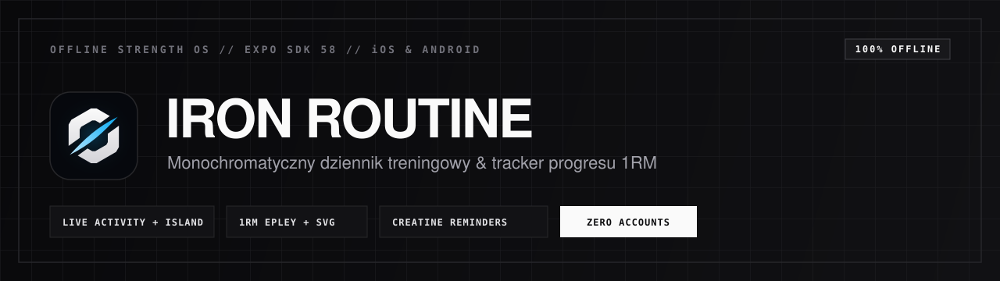

<div align="center">
  
  <br /><br />
  <p><b>Minimalistyczny, prywatny dziennik treningu siłowego, interaktywna anatomia 2D (F–S+) oraz szyfrowany E2EE komunikator ekipy — iOS, Android i Web · 5 języków · Offline-First</b></p>

  <p>
    <a href="https://iron-routine-app.vercel.app"></a>
    <a href="https://github.com/matiqueue/iron-routine/releases"></a>
    <a href="https://github.com/matiqueue/iron-routine/actions/workflows/ci.yml"></a>
    <a href="https://iron-routine-app.vercel.app/privacy"></a>
  </p>
</div>

> **Portal, wsparcie i polityka prywatności:** [iron-routine-app.vercel.app](https://iron-routine-app.vercel.app) · [Prywatność](https://iron-routine-app.vercel.app/privacy) · [Regulamin](https://iron-routine-app.vercel.app/terms) · [Wsparcie](https://iron-routine-app.vercel.app/support)

---

## Centralna dokumentacja projektu i pamięć dla AI

Projekt posiada jeden centralny system dokumentacji (Single Source of Truth), wspólny dla twórców i wszystkich agentów AI (ChatGPT/Codex, Claude, Gemini):

- **[AGENTS.md](./AGENTS.md)** — główne zasady pracy, komendy weryfikacji, standardy kodu i macierz aktualizacji dokumentacji (wskazywane przez `CLAUDE.md`, `GEMINI.md` i `.github/copilot-instructions.md`).
- **[docs/PROJECT_MEMORY.md](./docs/PROJECT_MEMORY.md)** — centralna pamięć projektu: wizja, założenia, funkcje, niezmienniki bezpieczeństwa, decyzje architektoniczne (ADR), dług technologiczny i roadmapa.
- **[docs/ARCHITECTURE.md](./docs/ARCHITECTURE.md)** — mapa katalogów, nawigacja, klucze `AsyncStorage`, schemat Neon PostgreSQL, endpointy Vercel API i zasady wydajności.
- **[docs/RELEASE_AND_STORES.md](./docs/RELEASE_AND_STORES.md)** — procedura SemVer, publikacja iOS App Store / TestFlight, Android Google Play (`.aab`), podpisywanie i CI/CD.
- **[CHANGELOG.md](./CHANGELOG.md)** — historia wydań w standardzie Semantic Versioning.

---

## Najważniejsze funkcje (`v3.1.1`)

- **Trening w kolejce (120 FPS Hero Pager):** Płynne karty treningów w kolejności (bez sztywnego przywiązania do dni tygodnia), rozgrzewka, szybki start/wznowienie i opcja wstrzymania lub skasowania postępu.
- **Interaktywna Anatomia 2D i Rangi (F–S+):** Sylwetka męska i kobieca z trybem pełnoekranowego zoomu, 19 partii mięśniowych, drabina rang oraz baza **136+ ćwiczeń** ze zdjęciami pozycji startowej/końcowej.
- **Statystyki i Dziennik Ciała:** Pierścień 30-dniowy i tonaż, interaktywny wykres masy ciała (z wpisami w dni wstecz), spektrum BMI, wykres 7-tygodniowy, heatmapa 28 dni i animowany dziennik suplementacji.
- **Natywny iOS & Android:** **Dynamic Island / Live Activities** z 3-falowym alarmem `rest_alarm.wav`, **Apple HealthKit** / **Google Health Connect**, synchronizacja Kalendarza i Przypomnień, skróty Siri AppIntents.
- **Prywatność, Chmura i Szyfrowany Czat E2EE:** Praca 100% offline lub opcjonalna synchronizacja w **Neon PostgreSQL (`AES-256-GCM`)** przez natywne **Sign in with Apple (Face ID + JWKS)** i **Google (`ASWebAuthenticationSession`)**. Czat ze znajomymi chroniony **Curve25519 + XSalsa20-Poly1305**, z funkcjami zgłaszania, blokowania i trwałego usuwania konta w aplikacji.

---

## Stack technologiczny

- **Mobile & Web:** Expo SDK 58 · React Native 0.88 · TypeScript
- **Pamięć lokalna & Kryptografia:** `AsyncStorage`, `expo-crypto`, `tweetnacl` (`Curve25519 / XSalsa20-Poly1305`)
- **Autoryzacja & Backend:** `expo-apple-authentication`, `expo-web-browser`, Clerk, Vercel Serverless Functions, Neon PostgreSQL (`AES-256-GCM`)
- **Portal WWW (`website/`):** React 19 · Vite · TypeScript · Tailwind CSS

---

## Szybki start i wydawanie

```bash
npm install
npm run web                 # Podgląd webowy (http://localhost:8081)
npx tsc --noEmit            # Weryfikacja TypeScript (mobile)
npm run version:patch       # Atomowe podbicie SemVer (mobile + iOS + Android + website)
./scripts/deploy.sh         # Release build na podłączony fizyczny iPhone
./scripts/release-ios-appstore.sh  # Archiwum i upload do App Store Connect / TestFlight
```

Wydania Android (podpisany **Google Play `.aab`** + **`.apk`**) budują się automatycznie w GitHub Actions po wypchnięciu taga SemVer (`vX.Y.Z`) na gałąź `main`.

---

## Współtworzenie

- **Main Contributor:** [Szymon Góral (@matiqueue)](https://github.com/matiqueue)
- Pull Requesty kierujemy na gałąź **`dev`**, a produkcja wdrażana jest przez scalenie `dev` → `main`. Zobacz [CONTRIBUTING.md](./CONTRIBUTING.md), [CODE_OF_CONDUCT.md](./CODE_OF_CONDUCT.md) i [SECURITY.md](./SECURITY.md).
